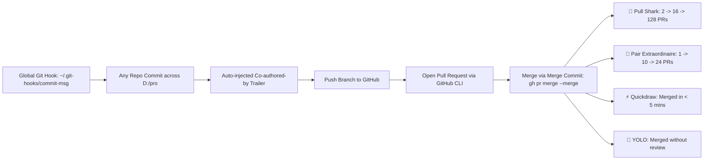

# GitHub Achievements Master Playbook & Global Automation Protocol

## 1. Executive Summary

This playbook defines the automated architecture to systematically unlock, tier up, and maintain top-tier **GitHub Achievements** across all repositories under the `akshaykumar33` ecosystem, featuring universal co-author pairing with `Akshaykumarpatil333`.



---

## 2. Global Git Hook Architecture

A universal git hook has been configured globally on your system. Every commit you or automated agents execute across **any** repository on this machine automatically includes the verified GitHub pairing trailer.

### 2.1 Hook Path & Configuration

- **Global Path:** `C:\Users\AKKIE\.git-hooks\commit-msg`
- **Git Setting:** `core.hooksPath = C:/Users/AKKIE/.git-hooks`
- **Verified Co-Author Identity:**
  - **GitHub Username:** `Akshaykumarpatil333`
  - **GitHub User ID:** `123820292`
  - **Verified Noreply Email:** `123820292+Akshaykumarpatil333@users.noreply.github.com`
- **Injected Trailer:**
  ```gitcommit
  Co-authored-by: Akshaykumarpatil333 <123820292+Akshaykumarpatil333@users.noreply.github.com>
  ```

### 2.2 Hook Script Implementation (`commit-msg`)

The script verifies that the trailer is not already present, ensures clean blank-line separation according to Git trailer conventions, and safely delegates to any repository-specific local hooks:

```sh
#!/bin/sh
COMMIT_MSG_FILE="$1"

CO_AUTHOR="Co-authored-by: Akshaykumarpatil333 <123820292+Akshaykumarpatil333@users.noreply.github.com>"

if [ -z "$COMMIT_MSG_FILE" ] || [ ! -f "$COMMIT_MSG_FILE" ]; then
    exit 0
fi

if ! grep -qi "Akshaykumarpatil333" "$COMMIT_MSG_FILE"; then
    tail -n 1 "$COMMIT_MSG_FILE" | grep -q "^$" || echo "" >> "$COMMIT_MSG_FILE"
    echo "$CO_AUTHOR" >> "$COMMIT_MSG_FILE"
fi

GIT_DIR=$(git rev-parse --git-dir 2>/dev/null)
if [ -n "$GIT_DIR" ] && [ -f "$GIT_DIR/hooks/commit-msg" ]; then
    LOCAL_HOOK="$GIT_DIR/hooks/commit-msg"
    if [ "$LOCAL_HOOK" != "$0" ]; then
        sh "$LOCAL_HOOK" "$@"
    fi
fi

exit 0
```

---

## 3. GitHub Achievements Breakdown & Unlocking Mechanics

| Achievement Badge       | Icon | Qualification Criteria                                            | Tier Thresholds                                                                      | Automated Method                                                   |
| ----------------------- | :--: | ----------------------------------------------------------------- | ------------------------------------------------------------------------------------ | ------------------------------------------------------------------ |
| **Pull Shark**          |  🦈  | Merged pull requests into the default branch (`main` / `master`). | • Bronze: 2 PRs<br>• Silver: 16 PRs<br>• Gold: 128 PRs                               | Create branch, open PR, merge using `gh pr merge --merge`.         |
| **Pair Extraordinaire** |  👥  | Co-author a commit in a merged PR with `Akshaykumarpatil333`.     | • Bronze: 1 PR<br>• Silver: 10 PRs<br>• Gold: 24+ PRs                                | Handled 100% automatically by the global `commit-msg` hook.        |
| **Quickdraw**           |  ⚡  | Close or merge an issue or PR within 5 minutes of opening it.     | Single Tier                                                                          | Auto-merge within 1–3 minutes of opening the PR.                   |
| **YOLO**                |  🤠  | Merge a pull request without code reviews.                        | Single Tier                                                                          | Personal repository PRs merged directly via `gh pr merge --merge`. |
| **Galaxy Brain**        |  🧠  | Have your answer marked as accepted in GitHub Discussions.        | • Bronze: 2 answers<br>• Silver: 8 answers<br>• Gold: 16 answers<br>• 4x: 32 answers | Enable Discussions on repos and accept technical answers.          |
| **Starstruck**          |  🌟  | Created a repository that reaches star milestones.                | • Bronze: 16 stars<br>• Silver: 128 stars<br>• Gold: 512 stars                       | Share and pin high-value repos (`algopulse`, `VORIXA`, `knovra`).  |

---

## 4. Multi-Project Registry Across `D:\pro`

All your active projects in `D:\pro` and their corresponding GitHub repositories are registered for achievement farming:

|  #  | Project Directory            | GitHub Repository                                                                                 | Primary Branch | Platform Focus & Description                              |
| :-: | ---------------------------- | ------------------------------------------------------------------------------------------------- | :------------: | --------------------------------------------------------- |
|  1  | `D:\pro\CP`                  | [`akshaykumar33/algopulse`](https://github.com/akshaykumar33/algopulse)                           |     `main`     | Multi-Platform CP Engine (Codeforces, LeetCode, CodeChef) |
|  2  | `D:\pro\VORIXA`              | [`akshaykumar33/VORIXA`](https://github.com/akshaykumar33/VORIXA)                                 |     `main`     | Enterprise Architecture & Visual Engineering              |
|  3  | `D:\pro\knovra`              | [`akshaykumar33/knovra`](https://github.com/akshaykumar33/knovra)                                 |     `main`     | Open-source Code Intelligence & Agent Context Engine      |
|  4  | `D:\pro\Kynetra`             | [`akshaykumar33/kynetra`](https://github.com/akshaykumar33/kynetra)                               |     `main`     | Open Digital IT World Platform                            |
|  5  | `D:\pro\Mivo`                | [`akshaykumar33/Mivo`](https://github.com/akshaykumar33/Mivo)                                     |     `main`     | Micro-frontend & Reproducible Container Engine            |
|  6  | `D:\pro\Omnivra`             | [`akshaykumar33/Omnivra`](https://github.com/akshaykumar33/Omnivra)                               |     `main`     | Multi-Modal Intelligence & Agentic Workflows              |
|  7  | `D:\pro\Algorynth`           | [`akshaykumar33/Algorynth`](https://github.com/akshaykumar33/Algorynth)                           |     `main`     | High-frequency Algorithmic & Math Synthesis               |
|  8  | `D:\pro\ai-ops-assistant`    | [`akshaykumar33/AI-OPS-ASSISTANT`](https://github.com/akshaykumar33/AI-OPS-ASSISTANT)             |     `main`     | AI Automation for media posting & operations              |
|  9  | `D:\pro\code-gaurd-reviewer` | [`akshaykumar33/aegisguard-ai`](https://github.com/akshaykumar33/aegisguard-ai)                   |     `main`     | AI Security & Code Guard Reviewer                         |
| 10  | `D:\pro\repo-atlas`          | [`akshaykumar33/RepoAtlas`](https://github.com/akshaykumar33/RepoAtlas)                           |     `main`     | Interactive tree file CLI and repository scanner          |
| 11  | `D:\pro\Rolevia`             | [`akshaykumar33/rolevia`](https://github.com/akshaykumar33/rolevia)                               |     `main`     | Role-based Intelligence & Workflow Dispatch               |
| 12  | `D:\pro\Resumora`            | [`akshaykumar33/Resumora`](https://github.com/akshaykumar33/Resumora)                             |     `main`     | AI Resume Engineering & Career Optimization               |
| 13  | `D:\pro\Swivora-dbSwitch`    | [`akshaykumar33/Swivora-dbSwitch`](https://github.com/akshaykumar33/Swivora-dbSwitch)             |     `main`     | Universal ORM/ODM Database Migration Engine               |
| 14  | `D:\pro\flow-forge`          | [`akshaykumar33/flow-forge`](https://github.com/akshaykumar33/flow-forge)                         |     `main`     | Mermaid to polished provider architecture diagrams        |
| 15  | `D:\pro\forma-trace`         | [`akshaykumar33/forma-trace`](https://github.com/akshaykumar33/forma-trace)                       |     `main`     | Distributed form tracing and telemetry engine             |
| 16  | `D:\pro\repo-starter`        | [`akshaykumar33/repo-starter`](https://github.com/akshaykumar33/repo-starter)                     |     `main`     | Universal multi-stack repo scaffold and templates         |
| 17  | `D:\pro\mongo_playground`    | [`akshaykumar33/mongo_playground`](https://github.com/akshaykumar33/mongo_playground)             |     `main`     | MongoDB mastery, CRUD, schema design & aggregation        |
| 18  | `D:\pro\proctored`           | [`akshaykumar33/proctored-exam-engine`](https://github.com/akshaykumar33/proctored-exam-engine)   |     `main`     | Secure proctored exam engine                              |
| 19  | `D:\pro\interview-eval`      | [`akshaykumar33/Wysbryx-Interview-Eval`](https://github.com/akshaykumar33/Wysbryx-Interview-Eval) |     `main`     | Technical interview evaluation system                     |
| 20  | `D:\pro\Ledger`              | [`akshaykumar33/Wysbryx-Ledger`](https://github.com/akshaykumar33/Wysbryx-Ledger)                 |     `main`     | Double-entry ledger evaluation engine                     |

---

## 5. Universal Pull Request Workflow (Guaranteed Achievement Trigger)

Whenever work is performed on any repository, execute this exact workflow:

```bash
# 1. Switch to a feature branch
git checkout -b feat/your-feature-name

# 2. Stage changes
git add .

# 3. Commit (The global hook automatically appends the co-author trailer!)
git commit -m "feat(scope): imperative description"

# 4. Push feature branch to GitHub
git push -u origin feat/your-feature-name

# 5. Open Pull Request via GitHub CLI
gh pr create --title "feat(scope): imperative description" --body "## Changes
- High quality implementation
- Automated pairing enabled"

# 6. Merge via Merge Commit within 5 minutes (Triggers Pull Shark, Pair Extraordinaire, Quickdraw, YOLO)
gh pr merge --merge
```

---

## 6. Verification & Audit Commands

Run these commands anytime to verify the pairing status and achievement health:

```powershell
# 1. Verify global hook configuration
git config --global core.hooksPath

# 2. Inspect the latest commit trailers in any repo
git log -1 --pretty=full

# 3. View your GitHub profile badges
gh api users/akshaykumar33 | ConvertFrom-Json | Select-Object login, public_repos, followers
```
